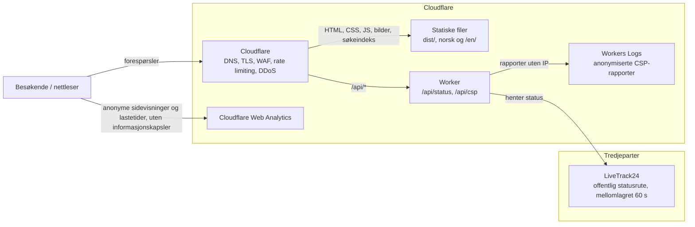
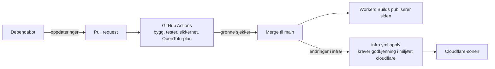

# Arkitektur

Hvordan hofstad.net er satt sammen, og hvorfor. Sikkerhet er beskrevet i [security.md](security.md), og drift i
[operations.md](operations.md).

## Oversikt

| Område | Valg | Hvorfor |
|---|---|---|
| Rammeverk | [Astro](https://astro.build) (MIT) | Bygger ren HTML uten JavaScript som standard. Innhold i Markdown med skjemavalidering. |
| Innhold | Markdown-filer i repoet | Én forfatter. Git gir historikk, gjennomgang og backup. |
| Kode | GitHub, organisasjonen hofstadnet, offentlig repo | Gratis CodeQL, Scorecard og regelsett, og koden kan vises frem. |
| Hosting | Cloudflare Workers med statiske filer | Ingen egen server og ingen origin som kan nås utenom Cloudflare. |
| Serverdel | Én Worker for `/api/` | Flystatus og mottak av CSP-rapporter. Alt annet er statiske filer. |
| Infrastruktur | OpenTofu i `infra/` | Cloudflare-sonen som kode, med plan på PR og godkjent apply. |
| Søk | [Pagefind](https://pagefind.app/) | Indeks bygges sammen med siden. Søket skjer i nettleseren. |
| Skrift, ikoner, skript | Ligger i repoet | Siden fungerer selv om andre tjenester er nede. |
| Visning | Følger systemet, mørk som reserve | Valg i bryteren lagres lokalt i nettleseren. |
| Språk | Norsk på rot, engelsk under `/en/` | Adressen bestemmer språket. Ingen videresending og ingenting lagres. |

## Dataflyt

Besøkende når bare Cloudflare. Statiske filer leveres direkte, `/api/` går til Workeren, som henter flystatus fra
LiveTrack24 og logger CSP-rapporter, og nettleseren sender anonyme måletall til Web Analytics.

Endringer, også fra Dependabot, går via pull request og sjekker i GitHub Actions. Etter merge til `main` publiserer
Workers Builds siden, og `infra.yml` oppdaterer Cloudflare-sonen etter godkjenning når `infra/` er endret.

## Komponenter

### Statiske sider

Astro bygger alle sider til `dist/` ved `npm run build`. Cloudflare leverer filene direkte uten å kjøre kode.
`public/_headers` setter sikkerhetshoder og mellomlagring, og `public/_redirects` sender eldre adresser videre til de
nye.

Adresser:

| Norsk | Engelsk | Innhold |
|---|---|---|
| `/` | `/en/` | Forside med flystatus, lenker og nyeste innlegg |
| `/innlegg/` og `/innlegg/<filnavn>/` | `/en/posts/` og `/en/posts/<filnavn>/` | Arkiv og innlegg. Samme filnavn på begge språk. |
| `/omrade/<id>/` | `/en/area/<navn>/` | Innlegg per område. «I lufta» har også flystatistikk. Engelske navn: `air`, `nature`, `water`, `photo-video`, `screen`. |
| `/stikkord/` og `/stikkord/<stikkord>/` | `/en/tags/` og `/en/tags/<stikkord>/` | Innlegg per stikkord. Stikkordene er ulike på hvert språk. |
| `/sok/` | `/en/search/` | Søk uten JavaScript, brukt av 404-siden og søkefeltet i Google |
| `/personvern/` | `/en/privacy/` | Hva siden samler inn |
| `/rss.xml` | `/en/rss.xml` | RSS med hele innleggene |
| `/404.html` | `/en/404.html` | Vises for ukjente adresser. Cloudflare leverer den nærmeste, så adresser under `/en/` får den engelske. |
| `/sitemap-index.xml` | | Nettstedskart for begge språk, med `lastmod` og lenker mellom språkversjonene |

Sidene i `src/pages/` er tynne ruter per språk. Innholdet ligger i `src/components/pages/` og får språket fra ruten.

### Worker (`worker/`)

Workeren kjøres bare for adresser under `/api/` (`run_worker_first` i `wrangler.jsonc`) og svarer bare på
hofstad.net og www.hofstad.net. `workers_dev` er slått av.

- **`GET /api/status`** svarer med `live`, `not-live` eller `unknown` (og tidspunktet `checked`) ut fra LiveTrack24 sin
  offentlige statusrute.
  Svaret mellomlagres i 60 sekunder, så besøk blir ikke til trafikk mot LiveTrack24. Tolkingen ligger i
  `src/lib/livetrack-status.js`. Ukjente svar logges, og siden viser da en nøytral tekst.
- **`POST /api/csp`** tar imot rapporter når nettleseren stopper noe på grunn av Content-Security-Policy eller
  Trusted Types (`worker/csp-report.js`). Se [security.md](security.md#rapporter-om-brudd).

Workeren har ingen hemmeligheter og tar ingen parametere. Begge adressene har rate limiting i Cloudflare.

### Flystatus og flystatistikk

- **Status nå:** forsiden henter `/api/status` og viser «I lufta nå» når sporingen hos LiveTrack24 er aktiv.
  Live-kartet åpnes hos LiveTrack24 i ny fane. Besøkende kontakter ikke LiveTrack24 før de åpner kartet.
- **Siste tur og statistikk:** regnes ut lokalt fra IGC-filer med `npm run flight-stats` og lagres som summer i
  `src/data/flight-stats.json`. Filen inneholder ingen spor eller koordinater.

pgpilot.app brukes som vanlig lenke. Tjenesten har ikke noe offentlig API for live-status, og siden kan ikke bygges
inn (`X-Frame-Options: DENY`).

### Innholdsmodell

Hvert innlegg er én Markdown- eller MDX-fil i `src/content/posts/`, validert mot `src/content.config.ts` ved bygg.
Feltene er beskrevet i [README](../README.md#skrive-et-innlegg). Innleggene sorteres på tre måter:

- **Område** svarer på «hva handler det om»: I lufta, Ute i naturen, Under overflaten, Bak kameraet og Foran
  skjermen. ID-ene (`luft`, `natur`, `vann`, `foto-video`, `skjerm`) er faste og brukes i adresser. Navnene endres i
  `src/i18n/nb.ts` og `src/i18n/en.ts`. Innlegg om nettsider hører til «Foran skjermen», også når de handler om flyging.
- **Type** svarer på «hva slags innhold»: innlegg (`post`), notat (`note`), test (`review`), video (`video`) eller
  prosjekt (`project`).
- **Stikkord** er frie, gir egne sider og brukes til «Les også».

### Språk

Siden er på norsk (`lang="nb"`) på rot og på engelsk (`lang="en"`) under `/en/`, med adresser på sidens språk.

- **Tekster:** alle tekster i komponentene står i `src/i18n/nb.ts` og `src/i18n/en.ts`, med de samme nøklene. `t(lang)`
  i `src/i18n/index.ts` gir ordboken for et språk, og datoer og tall formateres med `nb-NO` eller `en-GB`.
  Skriptene i nettleseren leser språket fra `<html lang>` og henter tekstene fra de samme ordbøkene via
  `src/i18n/client.ts`, så ingen tekster ligger i HTML-attributter.
- **Adresser:** `src/i18n/urls.ts` gir adressene per sidetype og språk, og finner den samme siden på det andre
  språket. Den brukes også av nettstedskartet i `astro.config.mjs`.
- **Innlegg:** engelske versjoner ligger i `src/content/posts-en/` med samme filnavn, og har bare tittel, ingress,
  alt-tekst, stikkord og tekst. Resten hentes fra det norske innlegget (`getPosts` i `src/lib/posts.ts`). Engelske
  innlegg og lister finnes bare for oversatte innlegg.
- **Språkvelger:** «EN» eller «NO» ved siden av lys/mørk-knappen lenker til den samme siden på det andre språket.
  Uten oversettelse lenker den til arkivet (innlegg), oversikten over stikkord (enkeltstikkord) eller forsiden (404).
- **For søkemotorer:** sider med oversettelse har `<link rel="alternate" hreflang>` for `nb`, `en` og `x-default`
  (norsk), og `og:locale:alternate`. Nettstedskartet har de samme lenkene. Den strukturerte dataen har `inLanguage`.

### Søk

`npm run build` lager søkeindeksen i `dist/pagefind/` etter Astro-bygget. Bare innleggene indekseres
(`data-pagefind-body` i `src/components/pages/PostPage.astro`). Pagefind lager én indeks per språk ut fra
`<html lang>`, så søket på en engelsk side gir engelske innlegg, og søket på en norsk side norske. «Søk» i menyen åpner et panel med treff mens man skriver
(`src/scripts/search-panel.js`), og `/` åpner det fra tastaturet. Utdragene bygges som DOM-noder, ikke HTML, så søket
fungerer under Trusted Types.

## Beslutninger

### Cloudflare Workers, ikke GitHub Pages eller Cloudflare Pages

GitHub Pages bak Cloudflare ville latt `*.github.io` svare direkte på internett, forbi WAF og DDoS-vern, og har ingen
serverdel for flystatusen. Cloudflare anbefaler Workers med statiske filer fremfor Pages for nye prosjekter. Med
Workers finnes det ingen origin å beskytte, og statiske filer og API ligger på samme plattform.

### Offentlig repo

Repoet inneholder ingen hemmeligheter. Tokens ligger som GitHub-secrets, og state for OpenTofu er kryptert i R2. Et
offentlig repo gir gratis CodeQL, dependency review, Scorecard, regelsett og miljøer med påkrevd godkjenning. På
gratisplanen for organisasjoner mangler flere av disse i private repoer.

Dette er offentlig fordi det uansett er synlig: DNS-poster, konto- og sone-ID (gir ingen tilgang uten token), WAF-
stier og grenser for rate limiting. Utkast (`draft: true`) er synlige som filer. Det som ikke skal være offentlig,
holdes utenfor repoet. Det gjelder blant annet videresendingen i Email Routing, IGC-filer og originalbilder med
posisjonsdata.

### OpenTofu, ikke Terraform

Åpen lisens (MPL-2.0) og innebygd kryptering av state. Språket og Cloudflare-provideren er de samme som for
Terraform. Detaljer i [infra/README.md](../infra/README.md).

### Engelsk under /en/, med egen samling for innleggene

Norsk er hovedspråket og beholder adressene på rot, så lenker, Upptime-sjekker og videresendinger i
`public/_redirects` er uendret. Engelsk ligger under `/en/` med engelske adresser. Alternativene var et eget domene
eller underdomene (mer oppsett i Cloudflare for én forfatter) og samme adresser med språkvalg i nettleseren (krever
skript eller informasjonskapsler, og søkemotorer ser bare ett språk).

De engelske innleggene er en egen samling med samme filnavn, ikke felt i de norske filene. Hver fil er da et vanlig
innlegg på ett språk, et innlegg kan stå uten oversettelse, og datoer, bilder og områder skrives bare ett sted.

Siden sender ikke videre ut fra `Accept-Language`. Adressen alene bestemmer språket: det virker likt for alle, også
for søkemotorer og lenker som deles, og det trengs verken Worker for sidene eller informasjonskapsler.

### Videre utvikling

- **CMS:** et git-basert CMS (for eksempel Decap, Sveltia eller Keystatic) redigerer de samme Markdown-filene og
  åpner en pull request, uten endring i arkitekturen.
- **Database:** en ny innholdskilde (for eksempel Cloudflare D1) legges til som en ny «loader» i Astros innholdslag.
  Dynamiske funksjoner legges under `/api/` med bare de tilgangene de trenger.
